<p align="center">
  
</p>

<p align="center">
  
  
  
  
  
</p>

<p align="center"><b>Tell your agent:</b></p>

> Use github.com/Felichz/frameproof to find out why scrolling stutters here, and fix it.

That's the whole setup. The agent reads [AGENTS.md](AGENTS.md), runs `npx -y github:Felichz/FrameProof next`, and the tool walks it through the rest. It comes back to you for one thing only: what matters, and what you won't trade away.


## What it finds


Every freeze gets a dossier, and a one-line verdict down to the source line:



## Whether a change worked


Two builds alternate in blocks in one session, so a drift in the machine falls on both. A first look that seems different only earns a confirmation run; only that run decides.

## How to read it


## Try it


```bash
cp -R examples/janky-shop /tmp/shop && cd /tmp/shop
npx -y github:Felichz/FrameProof next
```

Then run what `next` says, and `next` again. `frameproof guide` is the manual for the installed version.

<table>
<tr><th align="left">Ask</th><th align="left">Command</th><th align="left">Answer</th></tr>
<tr><td>What do I do now?</td><td><code>next</code></td><td>One action and its exact command</td></tr>
<tr><td>What froze, and why?</td><td><code>freezes</code> · <code>show</code> · <code>query</code></td><td>Causes grouped across repetitions, by source line</td></tr>
<tr><td>Is a fix worth it?</td><td><code>price --inject css:…</code></td><td>The change priced before it's made</td></tr>
<tr><td>Did it work?</td><td><code>compare</code></td><td>A verdict, an effect and its interval</td></tr>
<tr><td>Where does the work go?</td><td><code>ledger</code> · <code>check</code></td><td>Counted work, and budgets that fail CI</td></tr>
<tr><td>What did a scenario really do?</td><td><code>scenario check</code></td><td>Each step: done, failed, or did nothing</td></tr>
<tr><td>Can this machine measure?</td><td><code>doctor</code> · <code>calibrate</code></td><td>A self-test, the noise floor, the margins</td></tr>
<tr><td>What was tried before?</td><td><code>journal</code> · <code>report</code></td><td>Every experiment, written for a person</td></tr>
</table>

## Why not FPS, Lighthouse or a trace

| Signal | Where it fails |
|---|---|
| Average FPS | Moves with the machine's load, and hides the one 300 ms freeze a visitor feels |
| Lighthouse, Web Vitals | Page load and single interactions, not whether a scroll's frames arrived on time |
| A DevTools trace | Tens of megabytes, made for a person with a flame chart, not a context window |
| One before, one after | An anecdote: two runs of the same build differ more than most fixes do |

frameproof reads the frames Chrome's compositor reports, in a real window kept out of sight (headless composites differently), and answers in a few hundred tokens of JSON:

- **It can say "I don't know".** `inconclusive` is a result; `same` needs an interval inside a stated margin.
- **It checks itself.** A build against itself, and a known freeze injected, before its margins are trusted.
- **Typical frames and rare stalls apart.** A median and a rate of episodes answer different questions.
- **It refuses a busy machine.** A loaded laptop gives `not-measurable`, with what's using it, not a bad number.
- **It remembers.** Every experiment lands in `perf/JOURNAL.md`, so the next session doesn't retry a dead end.

## Where it comes from

<details>
<summary>The tooling that made <a href="https://portfolio-felix-teal.vercel.app/">my portfolio</a> fluid, where an agent ran the measuring and I decided the trade-offs.</summary>

<br>

Measured there with the A/B described here:

| Change | Late frames a step, at 4x CPU |
|---|---|
| A video page stops checking the clock every frame: opening a window | 17.4 → 11.0, p < 0.001 |
| The same, closing it | 15.6 → 6.6, p < 0.001 |
| A third-party frame no longer holds the first paint | 6.7 → 1.3, p < 0.001 |
| A 3D model's shaders linked in a worker | 860 ms → 25 ms of script on arrival |
| Flying a window with a transform (looked like a win) | 17.6 → 22.5, p = 0.008: worse, dropped |

The tooling also got things wrong, and those cases shaped this design: [what the original got wrong](PLAN.md#what-the-original-got-wrong).

</details>

## Status

**0.1.0, not on npm yet**: it runs from GitHub with `npx -y github:Felichz/FrameProof`. Checked on macOS (a 2020 Intel MacBook, Chrome 156) against [`examples/janky-shop`](examples/janky-shop) and on [KatArch](https://github.com/Felichz/katarch) (Astro); Windows and Linux runs are still to do. Phase by phase: [PLAN.md](PLAN.md#status).

Chromium only, since the data comes from Chrome's compositor. It measures on your machine and compares within one machine: not a monitoring product, no field data.

## License

[MIT](LICENSE).
